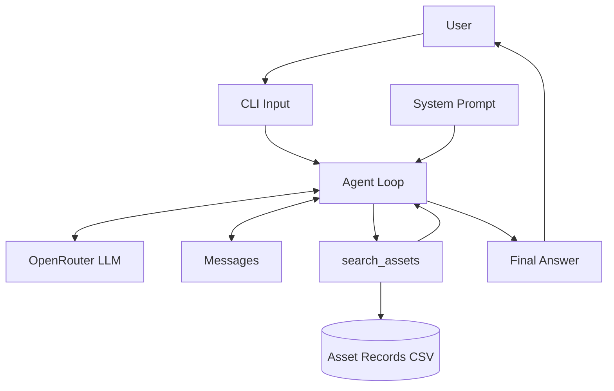
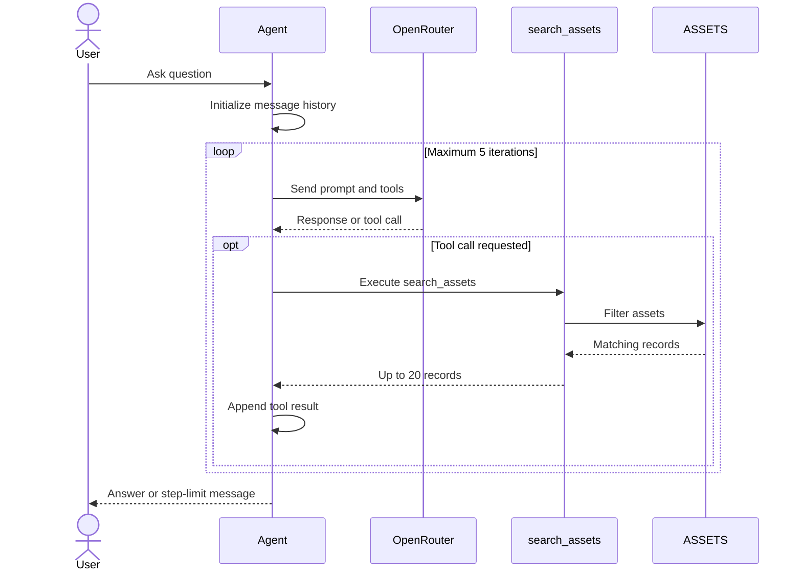

# Lab 1.3 — Agent Structure Analysis (UML)

## 1. Overview

This document analyzes the plant maintenance AI agent developed in Lab 1.1. The agent uses OpenRouter to answer questions about industrial maintenance assets stored in a CSV file.

The system uses an LLM, a tool-calling loop, short-term message history, and a Python search function. It does not have persistent memory or a separate planning engine.

## 2. Functional Requirements

- FR1: The agent shall accept natural-language questions about plant assets.
- FR2: The agent shall use an LLM through the OpenRouter API.
- FR3: The agent shall provide a search tool for asset records.
- FR4: The agent shall support filtering by status, criticality, asset type, and location.
- FR5: The agent shall preserve message and tool history within each request.
- FR6: The agent shall return matching asset information with asset IDs.
- FR7: The agent shall stop after a maximum of five model iterations.
- FR8: The agent shall indicate when available records cannot answer the question.

## 3. Component Diagram

## 4. Sequence Diagram

## 5. Design Observations

1. **Short-term memory:** The `messages` list is recreated for every new question. Previous conversations are not retained.
2. **Search limitation:** The search tool returns at most 20 matching assets, which may cause inaccurate counts when more than 20 records match.
3. **Limited planning:** The agent uses an iterative tool-calling loop, but no explicit planning or task-decomposition component.

## Conclusion

The agent demonstrates the core elements of an agentic AI system: prompt configuration, LLM integration, temporary memory, tool invocation, and environment interaction. Its architecture is simple and suitable for learning, but persistent memory and more reliable aggregation would improve its capabilities.